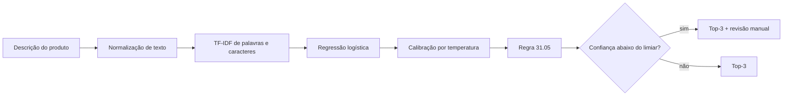
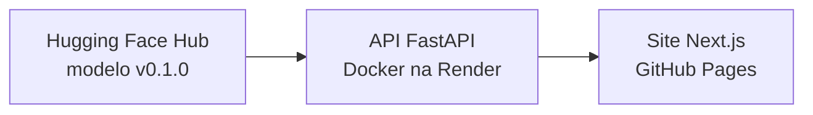

# NCM Classifier

[](https://github.com/amanda-gondra/ncm-classifier/actions/workflows/ci.yml)
[](https://github.com/amanda-gondra/ncm-classifier/actions/workflows/pages.yml)

Sugere a posição NCM (4 dígitos) de um produto do agronegócio a partir da descrição comercial,
do jeito que ela aparece num anúncio, numa licitação ou numa nota fiscal. Cada sugestão vem com
confiança calibrada e com um aviso quando o caso deve ir para revisão manual.

| | |
|---|---|
| **Demonstração** | https://amanda-gondra.github.io/ncm-classifier/ |
| **API** | https://ncm-classifier-api.onrender.com ([documentação](https://ncm-classifier-api.onrender.com/docs)) |
| **Modelo** | [`AmandaGondra/ncm-classifier`](https://huggingface.co/AmandaGondra/ncm-classifier) `v0.1.0` |
| **Dataset** | [`AmandaGondra/ncm-classifier-dataset`](https://huggingface.co/datasets/AmandaGondra/ncm-classifier-dataset) `v1.0.0` |

> **Aviso.** É uma ferramenta de apoio, não um parecer fiscal. A responsabilidade pela
> classificação permanece com quem emite a nota.

```bash
curl -X POST https://ncm-classifier-api.onrender.com/v1/predictions \
  -H "Content-Type: application/json" \
  -d '{"description": "ADUBO NPK 20-05-20 SC 50KG"}'
```

```text
1º 31.05  Adubos (fertilizantes) minerais ou químicos, que contenham dois ou três ...  99,2%
2º 31.02  Adubos (fertilizantes) minerais ou químicos, nitrogenados (azotados).         0,1%
3º 31.01  Adubos (fertilizantes) de origem animal ou vegetal, ...                       0,1%
revisão manual: não
```

A resposta real é JSON (veja [`docs/api.md`](docs/api.md)). No plano gratuito da Render, a API
dorme após 15 minutos sem uso e leva cerca de um minuto para acordar.

## O problema

Toda NF-e exige o código NCM de cada produto, escolhido entre mais de 10 mil subitens da tabela
oficial. Lojas agropecuárias e produtores costumam errar ou demorar nessa escolha, e a descrição
que eles têm em mãos raramente se parece com o texto legal ("ADUBO 20 5 20 SC 50KG" contra
"Adubos (fertilizantes) minerais ou químicos, que contenham dois ou três dos seguintes
elementos fertilizantes...").

O projeto mede, com um protocolo rigoroso, até onde um modelo de texto em português consegue
ajudar nessa tarefa, e entrega o resultado como um serviço que outra pessoa pode usar.

## Escopo

- **37 posições NCM** de produtos do agro: animais vivos, ovos, grãos e sementes, farelos e
  rações, sal, adubos, defensivos, arames e cercas, ferramentas, máquinas agrícolas, tratores e
  reboques ([lista completa](src/ncm_classifier/data/positions.json)).
- **Nível de posição (4 dígitos).** O projeto não inventa os 8 dígitos do subitem: isso exige
  informações que a descrição normalmente não traz.
- **Tabela oficial:** Classif, Portal Único Siscomex, "Vigente em 30/10/2026", Resolução Gecex
  nº 926/2026.

## Resultados

Modelo publicado: TF-IDF de palavras e caracteres + regressão logística, com calibração por
temperatura, regra 31.05 e limiar de revisão. Medido em dois testes congelados, com textos reais
copiados de fontes públicas e rotulados à mão, nunca usados em treino, calibração ou escolha de
hiperparâmetros.
Intervalos de 95% por bootstrap (1000 reamostragens).

| Métrica | test_v1 (146 linhas) | test_v2 (74 linhas) |
|---|---|---|
| Acerto top-1 | 94,5% [90,4–98,0] | 94,6% [89,2–98,7] |
| Acerto top-3 | 99,3% [98,0–100] | 100% [100–100] |
| F1 macro | 0,945 [0,894–0,978] | 0,920 [0,862–0,987] |
| Erro de calibração (ECE) | 0,075 | 0,062 |
| Enviados à revisão | 11,0% [6,2–16,4] | 13,5% [6,8–21,6] |
| Acerto top-1 dos não revisados | 98,5% [96,2–100] | 100% [100–100] |

O que esses números mostram:

- **O limiar de revisão funciona como prometido.** Ele foi ajustado fora da dobra para 95% de
  acerto nos casos aceitos; nos testes, os aceitos acertaram 98,5% e 100%.
- **Os dados sintéticos fizeram diferença.** Sem as 299 descrições escritas por LLM, o top-1 cai
  para 80,8% no test_v1 e 85,1% no test_v2. O test_v2 foi montado depois dos sintéticos
  justamente para medir isso sem viés.
- **BERTimbau não ganhou do baseline.** O fine-tuning do BERTimbau (no Kaggle) empatou no top-1
  dos testes juntos: diferença de 0,0 ponto [−3,6; +4,1], McNemar p = 1,00. Ele calibra melhor,
  mas aceitou 8 erros sem pedir revisão, contra 2 do baseline, e é cerca de 47 vezes mais lento
  em CPU. O modelo mais simples foi para produção
  ([comparação completa](docs/experiments/model_comparison.md), [ADR 0003](docs/adr/0003-escolha-do-modelo.md)).

Os testes são pequenos: diferenças de 2 a 3 pontos não são detectáveis com 220 linhas.

## Como funciona



- **Normalização** compartilhada entre treino e inferência (`ncm_classifier.text`), para que o
  modelo veja o mesmo texto nos dois momentos.
- **Regra 31.05.** Adubos do Capítulo 31 em embalagens de até 10 kg vão para a posição 31.05.
  Modelos de texto não comparam pesos com um limite, então, quando a descrição declara só pesos
  até 10 kg e a primeira sugestão é do Capítulo 31, a probabilidade do capítulo passa para a
  31.05 ([ADR 0002](docs/adr/0002-regra-31-05-revisao-manual-e-protocolo.md)).
- **Protocolo único.** Hiperparâmetros, temperatura e limiar de revisão são escolhidos nas
  mesmas 5 dobras estratificadas do treino. Os testes só são lidos depois que o modelo está
  final, e o SHA-256 de cada um é conferido.

### Entrega



- **Modelo** publicado no Hugging Face em formato skops (sem pickle arbitrário), com revisão
  fixa `v0.1.0`. A API recusa `main` ou "latest".
- **API** FastAPI em Docker, com validação de entrada, limite de taxa, CORS fechado por padrão e
  erros padronizados. Detalhes em [`docs/api.md`](docs/api.md).
- **Site** estático em Next.js + TypeScript, com tipos gerados do esquema OpenAPI da API.
  Detalhes em [`web/README.md`](web/README.md).

Custo de infraestrutura: zero ([ADR 0004](docs/adr/0004-hospedagem-gratuita-da-api.md)).

## Dados

| Fonte | Linhas no treino | Onde está |
|---|---|---|
| Descrições oficiais da tabela NCM | 359 | geradas da tabela por `scripts/build_train_set.py` |
| Descrições reais de anúncios e licitações | 242 | `data/labeled/train_real_v1.csv` |
| Descrições sintéticas, escritas por LLM e marcadas | 299 | `data/labeled/train_synthetic_v1.csv` |
| **Testes congelados** | 146 + 74 | `data/labeled/test_v1.csv`, `test_v2.csv` |

Os rótulos são validados no nível de posição, a partir do texto das posições e das notas legais.
As convenções de rotulagem e as fontes estão em [`data/labeled/README.md`](data/labeled/README.md).

Os textos reais pertencem aos seus autores e ficam no repositório só para reproduzir e auditar os
experimentos. Eles não estão no dataset publicado no Hugging Face, que tem apenas as descrições
oficiais e as sintéticas.

## Como reproduzir

Requer Python 3.11 ou superior. Os comandos do passo 2 foram executados de novo em 2026-11-03,
com a tabela "Vigente em 30/10/2026", e reproduziram byte a byte o arquivo de treino (SHA-256
`2c075ec4…`) e as predições do `baseline_v1` nos dois testes. O treino leva cerca de 2 minutos
em CPU.

```bash
python -m venv .venv
# Windows: .venv\Scripts\activate    Linux/macOS: source .venv/bin/activate
pip install -e ".[dev]"
pytest
```

**1. Tabela NCM oficial.** Baixe o JSON público do Classif e salve como
`data/raw/ncm_siscomex.json`:

```text
https://portalunico.siscomex.gov.br/classif/api/publico/nomenclatura/download/json?perfil=PUBLICO
```

A tabela muda com novas resoluções. Uma versão diferente de "Vigente em 30/10/2026" pode mudar
as descrições oficiais e, com elas, o arquivo de treino.

**2. Treino e avaliação.**

```bash
python scripts/build_ncm_table.py data/raw/ncm_siscomex.json
python scripts/build_train_set.py --sources real synthetic official --name train_v1
python scripts/train_baseline.py --train data/processed/train_v1.parquet --name baseline_v1 \
  --test data/labeled/test_v1.csv data/labeled/test_v2.csv
```

O relatório sai em `reports/baseline_v1.json`, com as predições em `reports/predictions/`.

**3. API e site locais.**

```bash
uvicorn ncm_classifier.api.main:create_app --factory --port 8000
```

A API baixa o modelo publicado; não precisa do treino local. Para rodar o site apontando para
ela, veja [`web/README.md`](web/README.md).

O experimento com BERTimbau roda no Kaggle, com GPU, a partir de
[`notebooks/bertimbau_finetuning_kaggle.py`](notebooks/bertimbau_finetuning_kaggle.py).

## Estrutura

```text
src/ncm_classifier/
├── text/         normalização de texto (treino e inferência)
├── data/         tabela NCM, posições do escopo e montagem do treino
├── models/       baseline e BERTimbau
├── evaluation/   protocolo, métricas, calibração, revisão e comparação
├── inference/    preditor compartilhado: top-3, confiança, regra 31.05 e revisão
└── api/          FastAPI: rotas, esquemas, middlewares e configuração
scripts/          tabela NCM, treino, comparação, publicação e verificação de deploy
data/labeled/     treino real e sintético, testes congelados com checksum
reports/          relatórios e predições dos experimentos
docs/             API, decisões de arquitetura (ADRs) e comparação de modelos
web/              site Next.js
tests/            pytest: unidade, API e integração
```

## Qualidade

A cada push, a CI roda ruff, mypy, pytest com cobertura (mínimo de 90% na API), confere se o
esquema OpenAPI do site está atualizado e roda lint, tipos, testes e build do site. Uma execução
manual também testa a API com o modelo baixado do Hugging Face e a imagem Docker.

## Decisões

| ADR | Decisão |
|---|---|
| [0001](docs/adr/0001-escopo-e-hospedagem.md) | Escopo: posição de 4 dígitos, testes congelados antes do treino, custo zero |
| [0002](docs/adr/0002-regra-31-05-revisao-manual-e-protocolo.md) | Regra 31.05, revisão manual e protocolo de avaliação compartilhado |
| [0003](docs/adr/0003-escolha-do-modelo.md) | Baseline em produção; BERTimbau como experimento documentado |
| [0004](docs/adr/0004-hospedagem-gratuita-da-api.md) | API na Render, porque os Spaces Docker passaram a exigir plano pago |

## Limitações

- **Só 37 posições.** Um produto fora do escopo recebe a posição mais parecida entre as 37, sem
  aviso de que está fora. A revisão manual pega parte desses casos, não todos.
- **Testes pequenos** (220 linhas no total). Os intervalos de confiança são largos.
- **Sintéticos escritos depois de ver o test_v1.** O test_v2 existe para medir esse viés.
- **Descrições muito curtas, siglas e marcas** ("Chocadeira", "TSP", "KLOPR") ainda erram ou
  dependem de pouco contexto.
- **A regra 31.05 soma toda a probabilidade do capítulo**, o que pode inflar a confiança de um
  erro. A alternativa está registrada na comparação, para ser medida fora da dobra.
- **Plano gratuito da Render:** sem garantia de disponibilidade e com espera para acordar.

## Licença

Código sob a licença [MIT](LICENSE). Os textos reais de terceiros em `data/labeled/` não estão
cobertos por ela (veja [`data/labeled/README.md`](data/labeled/README.md)). O dataset publicado
tem licença própria, descrita no
[cartão do dataset](https://huggingface.co/datasets/AmandaGondra/ncm-classifier-dataset).

---

Projeto de portfólio de Amanda Gondra ·
[GitHub](https://github.com/amanda-gondra) ·
[Hugging Face](https://huggingface.co/AmandaGondra)
