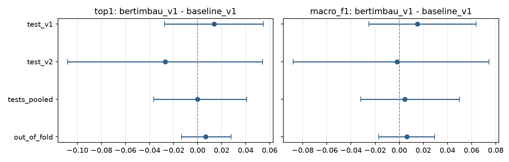

# Comparação: baseline (TF-IDF + regressão logística) × BERTimbau

- **Data:** 2026-11-03
- **Modelo A:** `baseline_v1` — TF-IDF de palavras e caracteres + regressão logística.
- **Modelo B:** `bertimbau_v1` — BERTimbau Base *cased*, fine-tuning no Kaggle (Tesla T4).
- **Diferenças:** sempre B − A.
- **Dados gerados por:** `scripts/compare_models.py` (`reports/comparison/comparison.json`,
  `per_example.csv`, `paired_differences.png`) e `scripts/benchmark_inference.py`
  (`reports/comparison/inference_benchmark.json`).

## A. Resumo executivo

**Na qualidade da classificação, os dois modelos são indistinguíveis com os dados que temos.**
Com os dois testes juntos (220 linhas), os dois acertam o top-1 em 94,55%. Cada um acerta 9
linhas que o outro erra (McNemar p = 1,0). Nas 900 linhas do treino, fora da dobra, o BERTimbau
fica 0,7 ponto acima, com intervalo de −1,3 a +2,8 pontos.

As diferenças reais estão em outros pontos:

- **O BERTimbau tem probabilidades mais bem calibradas no test_v1** (ECE 0,014 contra 0,075) e
  manda muito menos casos para revisão (2–4% contra 11–14%).
- **Em troca, ele erra com confiança alta com mais frequência.** Foram 8 erros aceitos sem
  revisão em 220 linhas, contra 2 do baseline.
- **O baseline é cerca de 50 vezes mais rápido, usa 6 vezes menos memória e ocupa 60 vezes
  menos disco.** Também é retreinado em CPU em cerca de 2 minutos.

**Recomendação técnica:** o baseline como modelo de produção e o BERTimbau como experimento
documentado. A decisão é da Amanda (seção G).

## Auditoria (antes de comparar)

Todas as verificações de `compare_models.py` passaram:

| Verificação | Resultado |
|---|---|
| Mesmo arquivo de treino (SHA-256 `2c075ec4…`) | ok |
| Mesmas 5 dobras (impressão digital `59611f67…`) | ok |
| Relatório do baseline gerado pelo mesmo código que o BERTimbau rodou (commit `529bf1c`) | ok |
| Testes iguais aos congelados (`70841daa…`, `034c834c…`) | ok |
| Cada modelo prediz todas as linhas, na ordem dos testes | ok |
| Predições batem com os relatórios de cada modelo | ok |
| Mesmas 37 classes, na mesma ordem | ok |
| Temperatura e limiar de revisão refeitos a partir das probabilidades fora da dobra batem com os relatórios | ok |

A regra da 31.05, a calibração e as métricas vêm das mesmas funções (`evaluation/report.py`).
Nenhum teste foi usado em treino, escolha de hiperparâmetros, calibração ou limiar.

## B. Comparação quantitativa

### Métricas finais (calibrado + regra 31.05), com intervalo de 95%

**test_v1 (146 linhas)**

| Métrica | Baseline | BERTimbau |
|---|---|---|
| top-1 | 0,945 [0,904–0,980] | 0,959 [0,925–0,986] |
| top-3 | 0,993 [0,980–1,000] | 0,993 [0,980–1,000] |
| macro F1 | 0,945 [0,894–0,978] | 0,960 [0,922–0,986] |
| macro precisão | 0,959 [0,903–0,986] | 0,973 [0,923–0,992] |
| macro recall | 0,949 [0,912–0,980] | 0,965 [0,940–0,987] |
| ECE calibrado (bruto) | 0,075 (0,450) | 0,014 (0,209) |
| Vai para revisão | 11,0% [6,2–16,4] | 2,1% [0,0–4,8] |
| top-1 dos aceitos | 98,5% [96,2–100] | 97,2% [94,4–99,3] |

**test_v2 (74 linhas)**

| Métrica | Baseline | BERTimbau |
|---|---|---|
| top-1 | 0,946 [0,892–0,987] | 0,919 [0,851–0,973] |
| top-3 | 1,000 [1,000–1,000] | 0,9865 [0,960–1,000] |
| macro F1 | 0,920 [0,862–0,987] | 0,918 [0,863–0,978] |
| macro precisão | 0,922 [0,853–0,993] | 0,914 [0,859–0,984] |
| macro recall | 0,927 [0,882–0,988] | 0,934 [0,884–0,982] |
| ECE calibrado (bruto) | 0,062 (0,455) | 0,057 (0,196) |
| Vai para revisão | 13,5% [6,8–21,6] | 4,1% [0,0–9,5] |
| top-1 dos aceitos | 100% [100–100] | 94,4% [88,7–98,6] |

### Diferenças pareadas (B − A)

O bootstrap pareado usa as mesmas 1000 reamostragens para os dois modelos, com semente 0. O
intervalo é da própria diferença. "B melhor" é a parcela das reamostragens em que o BERTimbau
fica acima.

| Conjunto | Linhas | top-1 | top-3 | macro F1 | Só A acerta / só B acerta | McNemar p |
|---|---|---|---|---|---|---|
| test_v1 | 146 | +1,4 pt [−2,7; +5,5] (B melhor em 69%) | 0,0 [−2,1; +2,1] | +1,5 [−2,5; +6,4] | 3 / 5 | 0,73 |
| test_v2 | 74 | −2,7 [−10,8; +5,4] (19%) | −1,4 [−4,1; 0,0] | −0,2 [−8,8; +7,4] | 6 / 4 | 0,75 |
| Testes juntos | 220 | 0,0 [−3,6; +4,1] (44%) | −0,5 [−2,3; +0,9] | +0,5 [−3,2; +5,0] | 9 / 9 | 1,00 |
| Treino, fora da dobra | 900 | +0,7 [−1,3; +2,8] (73%) | +0,1 [−1,2; +1,4] | +0,6 [−1,7; +2,9] | 41 / 47 | 0,59 |

**Interpretação.**
- Todos os intervalos das diferenças contêm o zero, e nenhum McNemar se aproxima de 0,05.
- O sinal da diferença troca entre os testes: o BERTimbau ganha no test_v1 e perde no test_v2.
- O teste mais informativo é fora da dobra, porque tem 900 linhas. Mesmo lá, o maior ganho
  plausível do BERTimbau é de uns 3 pontos, e uma pequena perda também é plausível.
- Fora da dobra, o BERTimbau tem uma vantagem de seleção: escolheu o melhor entre 20
  combinações (2 entradas × 10 épocas), contra 4 valores de C do baseline. Isso favorece
  levemente o BERTimbau nessa linha.

**Conclusão:** não há evidência de diferença na qualidade do top-1, do top-3 ou do macro F1.

### Por capítulo (top-1 da posição)

Só aparecem os capítulos em que os modelos diferem. Nos outros, os dois acertam igual.

| Capítulo | Teste | Linhas | Baseline | BERTimbau |
|---|---|---|---|---|
| 01 Animais vivos | test_v2 | 12 | 1,000 | 0,917 |
| 07 Leguminosas | test_v1 | 4 | 0,750 | 1,000 |
| 10 Cereais | test_v1 | 11 | 0,818 | 1,000 |
| 23 Rações | test_v1 | 14 | 0,857 | 0,929 |
| 25 Sal | test_v2 | 2 | 0,500 | 1,000 |
| 31 Adubos | test_v1 | 21 | 0,905 | 0,857 |
| 31 Adubos | test_v2 | 13 | 1,000 | 0,769 |
| 38 Inseticidas e herbicidas | test_v1 | 6 | 1,000 | 0,833 |
| 38 Inseticidas e herbicidas | test_v2 | 1 | 0,000 | 1,000 |
| 73 Obras de ferro ou aço | test_v2 | 7 | 0,857 | 1,000 |
| 84 Máquinas | test_v2 | 12 | 1,000 | 0,917 |

No Capítulo 31, o BERTimbau sempre acerta o capítulo, mas erra a posição dentro dele.

## C. Análise dos erros

Contagem por linha (`reports/comparison/per_example.csv`):

| Teste | Os dois acertam | Só baseline | Só BERTimbau | Os dois erram |
|---|---|---|---|---|
| test_v1 | 135 | 3 | 5 | 3 |
| test_v2 | 64 | 6 | 4 | 0 |

### Só o baseline acerta (9)

| Linha | Correta | BERTimbau | Texto (resumo) | Padrão |
|---|---|---|---|---|
| t045 | 38.08 | 31.05 | Glifosato 72%… saco 5 kg | Regra 31.05 amplificou um erro |
| t077 | 01.04 | 01.03 | Matriz caprina Anglo Nubiana | Raça/categoria animal |
| t104 | 31.03 | 31.05 | Superfosfato simples… saco de 50 kg | 31.03 × 31.05 |
| v004 | 01.02 | 01.03 | Garrote girolanda 10 meses | Raça/categoria animal |
| v030 | 23.09 | 38.08 | Mineral bovinos repelente c/ alho 10 kg | Palavra enganosa ("repelente") |
| v037 | 31.03 | 31.05 | Superfosfato triplo, saca com 50 kg | 31.03 × 31.05 |
| v038 | 31.03 | 31.05 | Superfosfato triplo granulado | 31.03 × 31.05 |
| v044 | 31.05 | 31.02 | Ureia… "Com 5k" | Peso fora do padrão |
| v064 | 84.36 | 23.09 | "Chocadeira" | Descrição de uma palavra |

### Só o BERTimbau acerta (9)

| Linha | Correta | Baseline | Texto (resumo) | Padrão |
|---|---|---|---|---|
| t032 | 23.02 | 23.04 | Farelo de trigo… proteína 14% | 23.02 × 23.04 (farelos) |
| t036 | 10.06 | 12.09 | Sementes de arroz (variedades) | "Sementes" puxa para 12.09 |
| t037 | 07.13 | 12.09 | Sementes de feijão (variedades) | "Sementes" puxa para 12.09 |
| t079 | 01.02 | 01.04 | Novilhas Jersey | Raça animal |
| t116 | 10.06 | 12.13 | Arroz cateto em casca | "Casca" puxa para 12.13 |
| v028 | 23.09 | 25.01 | Sal mineral… cloreto de sódio | Sal mineral × sal |
| v032 | 25.01 | 01.04 | Bloco de sal rosa KLOPR 3 kg | Marca e espécies no texto |
| v046 | 38.08 | 23.09 | Fipronil 80% granulado | Princípio ativo sem contexto |
| v053 | 73.17 | 73.13 | Grampo para cerca de arame farpado | Produto × matéria-prima |

### Os dois erram (3)

| Linha | Correta | Baseline | BERTimbau | Texto (resumo) |
|---|---|---|---|---|
| t034 | 23.09 | 23.02 | 23.04 | Ração concentrada de aves com farelos |
| t048 | 31.03 | 31.05 | 31.01 | Sacos com 50 kg de adubo supersimples |
| t106 | 31.03 | 12.09 | 31.05 | "TSP" de alta disponibilidade (sigla) |

### Padrões

1. **31.03 × 31.05 é a fraqueza principal do BERTimbau** (t104, v037, v038, e também t106). Ele
   associa "superfosfato" à 31.05 mesmo com "50 kg" escrito no texto. O baseline acerta esses
   casos. É o mesmo limite que motivou a regra: modelos de texto não comparam o peso com 10 kg.
   A regra só corrige o caminho inverso (Capítulo 31 → 31.05 quando o peso é pequeno). Ela não
   tira da 31.05 um texto com 50 kg.
2. **O BERTimbau é melhor quando o texto é longo e descritivo** (sementes com variedades, arroz
   em casca, farelos com composição, princípios ativos). O baseline se deixa levar por uma
   palavra forte ("sementes" → 12.09, "casca" → 12.13).
3. **Animais por raça ou categoria se dividem:** t077 e v004 a favor do baseline, t079 a favor
   do BERTimbau. Nomes de raça (Girolanda, Anglo Nubiana, Jersey) aparecem pouco no treino.
4. **Descrições incompletas, siglas e marcas** erram nos dois modelos ou trocam de lado:
   "Chocadeira" sozinha, "TSP", "KLOPR". Isso pede mais exemplos curtos no treino, não um
   modelo maior.
5. **Peso, embalagem e composição:** "Com 5k" (v044) não é lido como peso pela regra, e só o
   baseline acerta, provavelmente pelos n-gramas de caracteres de "npk 46-00-00". Os casos de
   50 kg estão no item 1.

### Posição 31.05 e o erro v045

| Linha | Correta | Top-1 bruto do baseline | Top-1 bruto do BERTimbau | Regra | Resultado |
|---|---|---|---|---|---|
| t008 | 31.05 | 31.02 | 31.02 | nos dois | os dois corrigidos |
| t009 | 31.05 | 31.04 | 31.04 | nos dois | os dois corrigidos |
| v045 | 31.05 | 31.03 | 31.03 | nos dois | os dois corrigidos |
| t045 | 38.08 | 38.08 | 31.03 | só no BERTimbau | continua errado, agora com confiança 0,98 |

- **O v045, que motivou a regra, também foi errado pelo BERTimbau antes da regra.** A regra
  corrigiu nos dois modelos. Isso confirma que o problema é do tipo de modelo, não do TF-IDF.
- **No t045 a regra não criou o erro.** O BERTimbau já tinha posto o herbicida no Capítulo 31.
  Mas, ao somar na 31.05 toda a probabilidade do capítulo, ela subiu a confiança para 0,98, e o
  erro escapou da revisão.
- **Melhoria possível:** em vez de somar o capítulo inteiro, transferir só a probabilidade da
  posição escolhida. Essa mudança precisa ser decidida e medida fora da dobra, nunca nestes
  testes.

### Erros com confiança alta (aceitos sem revisão)

| Modelo | Erros aceitos (220 linhas) | Linhas |
|---|---|---|
| Baseline | 2 | t036, t116 |
| BERTimbau | 8 | t034, t045, t048, t104, v030, v037, v038, v044 |

Fora da dobra, os dois limiares mandam uma parcela parecida para revisão (14,9% e 13,3%).
Nos testes, o BERTimbau final ficou bem mais confiante (2–4% para revisão).

Uma explicação provável: o modelo final do BERTimbau treina com 900 linhas, contra 720 de cada
modelo de dobra, pelo mesmo número de épocas. Ele sai mais confiante que os modelos que
calibraram a temperatura e o limiar. No baseline, esse efeito é bem menor (11–14%).

## D. Análise operacional

Medido no computador da Amanda: Windows 11, Intel de 8 núcleos lógicos, 8,4 GB de RAM, só CPU.
Os 146 textos do test_v1 foram usados só como entrada, sem rótulos. Cada modelo rodou num
processo separado.

| Item | Baseline | BERTimbau | Razão |
|---|---|---|---|
| Latência, um texto por vez (mediana) | 1,3 ms | 63,1 ms | ~47× |
| Latência p95 | 2,6 ms | 78,1 ms | ~30× |
| Lote, por texto | 0,14 ms | 44,6 ms | ~320× |
| Memória adicionada (bibliotecas + modelo) | 96 MB | 655 MB | ~7× |
| Carregamento (import + modelo) | 2,1 s | 9,9 s | ~5× |
| Modelo em disco | 7,3 MB | 436,5 MB | ~60× |
| Bibliotecas instaladas | 235 MB | 739 MB | ~3× |

Valores de `reports/comparison/inference_benchmark.json`. Uma execução anterior no mesmo
computador deu 65,6 ms de mediana e 101 ms de p95 para o BERTimbau. A ordem de grandeza se
repete, mas os valores exatos variam alguns por cento entre execuções.

| Aspecto | Baseline | BERTimbau |
|---|---|---|
| Dependências | scikit-learn, scipy, numpy | PyTorch, Transformers, tokenizers |
| Retreino | ~2 min em CPU, no próprio PC | GPU (Kaggle), ~8 min de treino mais preparação manual |
| Implantação gratuita (HF Spaces CPU) | folgada | cabe, mas cada pedido custa ~50–100 ms e a imagem é maior |
| Atualização com dados novos | rodar um script | notebook no Kaggle, baixar artefatos, publicar 436 MB |
| Manutenção | baixa | média: versões de PyTorch e Transformers, revisão do modelo base |

Custo em dinheiro: zero para os dois no plano gratuito. A diferença está no tempo de resposta,
na memória do servidor e no trabalho de retreinar.

## E. Limitações

- **Testes pequenos.** 220 linhas não detectam diferenças de 2–3 pontos. O intervalo dos testes
  juntos vai de −3,6 a +4,1 pontos.
- **Semente única no BERTimbau.** O fine-tuning com poucos dados varia entre sementes. Não medimos
  essa variação; outra semente poderia mudar alguns acertos.
- **A época escolhida foi a última da grade (10).** O macro F1 fora da dobra ainda subia devagar
  (0,8695 → 0,8715 da época 9 para a 10). Mais épocas podem ajudar um pouco, mas isso só pode
  ser decidido fora da dobra.
- **A calibração do BERTimbau não se transfere bem para o modelo final** (seção C). A meta de
  95% nos aceitos não se manteve no test_v2 (94,4%).
- **Os dados sintéticos foram escritos depois de ver o test_v1.** O test_v2 existe para medir
  isso; o resultado no test_v2 favorece levemente o baseline.
- **Latência medida em um computador**, de uso pessoal. Em servidor os números absolutos mudam,
  mas a ordem de grandeza da razão deve se manter.
- **As categorias de erro da seção C são leitura manual** das linhas, não uma medida automática.

## F. Recomendação técnica

**Modelo recomendado para produção: baseline (`baseline_v1`), com a regra da 31.05 e o limiar
de revisão.**

**Justificativa.** Pelo princípio desta etapa (desempenho comprovado, confiabilidade e
viabilidade operacional), o baseline:
- empata na qualidade medida;
- erra menos sem pedir revisão (2 contra 8 erros aceitos em 220 linhas);
- custa uma fração para servir e para retreinar.

**Vantagens do baseline**
- Rápido (~1 ms), leve (~100 MB) e com dependências simples.
- Retreino em CPU em minutos.
- Os erros que ele comete com confiança alta são poucos; quando ele não sabe, manda para
  revisão.
- Fácil de explicar: dá para mostrar quais palavras pesaram.

**Desvantagens do baseline**
- Manda mais casos para revisão (11–14% contra 2–4%), ou seja, mais trabalho humano.
- Probabilidades piores no test_v1 (ECE 0,075 contra 0,014).
- Erra textos descritivos guiados por uma palavra forte ("sementes", "casca").

**Riscos**
- Se o volume real for grande, 11–14% de revisão pode ser caro.
- A vantagem de calibração do BERTimbau pode ser real e não aparecer só por causa do tamanho dos
  testes.

**O que mudaria a decisão**
- Um test_v3 maior (300 linhas ou mais, de fontes novas) mostrando ganho consistente do
  BERTimbau.
- Várias sementes do BERTimbau com média acima do baseline fora da dobra.
- Se o custo da revisão humana pesar mais do que latência e manutenção.
- Uma combinação dos dois modelos (média das probabilidades), escolhida só fora da dobra e
  avaliada num teste novo. Os testes atuais já foram vistos e não servem para decidir isso.

## G. Decisão pendente (Amanda)

Escolha qual modelo entra na API, no Space e no README:

1. **Baseline em produção; BERTimbau como experimento documentado** (recomendado). A API e o
   Space usam o baseline. O README mostra a comparação e por que o modelo mais simples ganhou.
2. **BERTimbau em produção.** Menos revisão e probabilidades melhores no test_v1, ao custo de
   ~50× mais latência, mais erros aceitos sem revisão e retreino com GPU.
3. **Baseline na API; os dois lado a lado no Space**, como demonstração. Mostra os dois modelos,
   mas dobra o trabalho de publicação.

Até a decisão, nada muda na arquitetura: nenhum modelo foi trocado e nenhum experimento foi
apagado.
